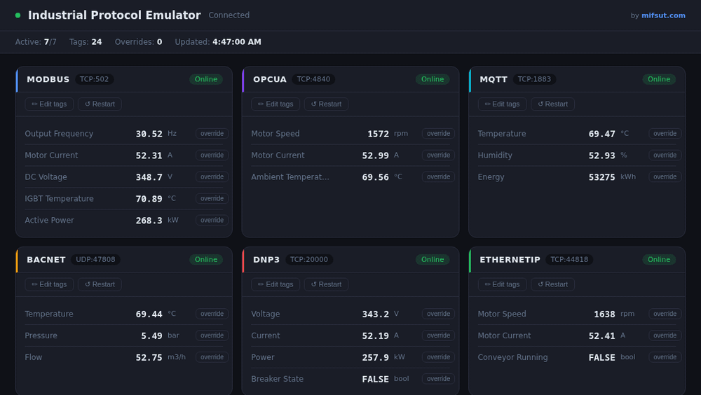

# Industrial Protocol Emulator

One container, seven industrial protocols, live-varying signals, and a web panel. Point your SCADA, driver or gateway at it instead of real hardware.

**Modbus TCP · OPC-UA · MQTT · BACnet/IP · DNP3 · EtherNet/IP · SNMP**



## Run it

```bash
docker run --rm --name ipe -p 8080:8080 -p 502:502 -p 4840:4840 -p 1883:1883 -p 20000:20000 -p 44818:44818 -p 47808:47808/udp -p 161:161/udp ghcr.io/joseluisnebot/industrial-protocol-emulator:latest
```

Open the panel at **http://localhost:8080**. No other services needed: an MQTT broker (Mosquitto) is embedded in the image.

Prefer compose? `docker compose up -d` does the same (see [docker-compose.yml](docker-compose.yml)).

> **Linux, BACnet discovery:** BACnet `Who-Is` is a broadcast and does not cross Docker's port mapping. If you need discovery, use `--network host` instead of the `-p` flags.

## What it exposes

| Protocol | Port | Transport | Notes |
|---|---|---|---|
| Web panel / REST / WebSocket | 8080 | TCP | live values, overrides, tag editor |
| Modbus TCP | 502 | TCP | holding registers from address 0, float32 (2 registers per tag), any unit id |
| OPC-UA | 4840 | TCP | `opc.tcp://<host>:4840/emulator/`, anonymous; browse `Objects/Motor`, `Objects/Temp` |
| MQTT | 1883 | TCP | embedded Mosquitto, anonymous; topics like `plant/sensor1/temperature`, JSON payload `{"value","unit","ts"}` |
| BACnet/IP | 47808 | UDP | device instance 999, Analog Input objects |
| DNP3 | 20000 | TCP | **stub**, see limitations |
| EtherNet/IP | 44818 | TCP | **minimal**, see limitations |
| SNMP | 161 | UDP | v1/v2c, community `public`, enterprise OIDs under `1.3.6.1.4.1.9999.1.x.0` |

Quick checks once it is running:

```bash
snmpget -v2c -c public localhost 1.3.6.1.4.1.9999.1.1.0     # CPU load (Gauge32)
mosquitto_sub -h localhost -t '#' -v                         # MQTT stream
curl -s localhost:8080/api/state                             # all tags, all protocols
```

## Web panel

- **Live values** for every tag on every protocol, pushed over WebSocket.
- **Signal override** per tag: choose a pattern (sine, ramp, random walk, constant) and a min/max range; reset to auto at any time. Overrides live in memory and reset on restart.
- **Tag editor**: add, rename or remove tags per protocol; saved to JSON and applied by restarting only that protocol's server.
- **Config generator**: ready-to-paste YAML device config for each protocol, with the host you type in.
- **Status badge** per protocol (up / down and why).

## Limitations

This is a test tool, not a process simulator. Please read before relying on it:

- **DNP3 is a stub.** It answers Class 0 / integrity polls with analog inputs only (Group 30 Var 5). No events, no unsolicited responses, no controls, no secure authentication. Do not use it to validate a real DNP3 master beyond "can it connect and read analogs".
- **EtherNet/IP is minimal.** A small hand-written CIP responder (the optional `cpppo` backend is not installed in the image). Check it against your driver before trusting it; it is not a full CIP implementation.
- **SNMP** supports v1 and v2c only. No SNMPv3, no traps.
- **BACnet** exposes Analog Input objects only, with a fixed device instance (999).
- **OPC-UA** is anonymous, no encryption or certificates.
- **No authentication or TLS anywhere**, including the web panel and the REST API. Run it on a lab or local network, **never exposed to the internet**.
- **Signals are synthetic and independent of each other.** By default every tag is a noisy sine whose range is picked from its unit (e.g. Hz 0–60, °C −20–150, V 200–480), so values can fall outside a tag's nominal range. Ramp, random walk and constant, and custom ranges, are available through the per-tag override.
- Tested with the clients named above; not conformance-tested against any vendor stack.

Bug reports and PRs that improve the weak spots (especially DNP3 and EtherNet/IP) are welcome.

## REST API

```
GET  /api/state                          # full snapshot
GET  /api/protocols                      # tag definitions per protocol
POST /api/override/{protocol}/{tag_id}   # body: {"min":0,"max":100,"pattern":"sine"}
                                         # empty body {} -> back to auto
GET  /api/yaml/{protocol}?host=IP        # generate device YAML
WS   /ws                                 # real-time updates
```

## Configuration

| Variable | Default | Meaning |
|---|---|---|
| `MQTT_HOST` | `localhost` | If unset or `localhost`, the embedded Mosquitto starts. Set it to use your own broker instead. |
| `MQTT_PORT` | `1883` | Broker port |

Custom tags are saved to `data/custom_tags.json` inside the container; mount a volume on `/app/data` to keep them: `-v ipe-data:/app/data`.

## Build from source

```bash
git clone https://github.com/joseluisnebot/industrial-protocol-emulator
cd industrial-protocol-emulator
docker build -t ipe . && docker run --rm -p 8080:8080 -p 502:502 -p 4840:4840 -p 1883:1883 -p 20000:20000 -p 44818:44818 -p 47808:47808/udp -p 161:161/udp ipe
```

Without Docker (Python 3.11+, needs a Mosquitto or other MQTT broker, root for ports < 1024):

```bash
pip install -r requirements.txt
MQTT_HOST=localhost python -m simulator.main
```

## Project layout

```
simulator/
├── main.py              # asyncio orchestrator, per-protocol restart
├── config.py            # default tags + persistent JSON config
├── state.py             # shared state + WebSocket pub/sub
├── data_generator.py    # signal generators
├── protocols/           # one module per protocol
└── web/                 # FastAPI app + single-page UI
```

## About

Built by [mifsut.com](https://mifsut.com). MIT licensed, see [LICENSE](LICENSE).
